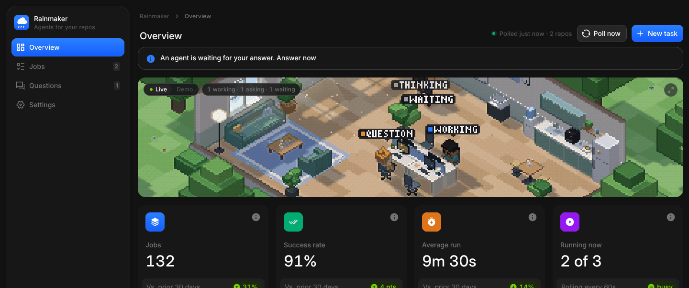

# Rainmaker

A lightweight Umbrel app that turns labeled GitHub issues into pull requests by running Claude Code or Codex.

Add `agent:ready` to an issue. Rainmaker picks it up, runs the agent in a fresh worktree, pushes a branch, opens a pull request that closes the issue, and moves the label to `agent:done` (or `agent:failed`, with the reason in a comment).

## How it works

```
agent:ready ──► agent:working ──► agent:done    (PR opened, comment on the issue)
                              └─► agent:failed  (comment with the error and last log lines)
```

1. Every poll interval (default 60s), Rainmaker lists open issues labeled `agent:ready` in the repos you watch. Polls use ETags, so quiet repos don't use up your GitHub rate limit.
2. It checks who applied the label. Only you (the token's owner) or users you list can trigger a run. Anyone else's label is removed with a comment.
3. It reads the issue's other labels to choose the agent, model and skills (see below), then queues a job.
4. The job gets its own git worktree on branch `rainmaker/issue-<n>` from the default branch. Runtimes from the repo's version files are installed with mise, and Godot projects get the exact Godot build from `project.godot`.
5. Claude Code (`claude -p`, stream-json) or Codex (`codex exec --json`) runs headless with the issue, its discussion, and instructions to commit but not push.
6. Rainmaker commits anything left uncommitted, pushes the branch, opens the PR with the agent's summary, and records tokens, cost, turns and duration.

Closing the issue or removing `agent:working` cancels the job. Retrying from the dashboard (or re-adding `agent:ready`) starts over on the same branch, so the PR updates in place.

## Dashboard

The dashboard shows 30-day metrics, running jobs, every job with its live log and summary, questions waiting for you, and all settings. You can file a new task or start an existing issue from it, and it works on a phone.

It is a React app in `web/`, built from [BoardUI](https://www.boardui.com) components, and the server serves the built files. It has five themes: Graphite (dark, the default), Daylight, Midnight, Ember and Matrix (high contrast). Pick one in the sidebar or under Settings, Appearance. `docs/ui-components.md` lists the components in use and the ones that fit future features.

At the top of the Overview is the office: a small isometric pixel-art room where four agents wander, make coffee, water the plants, and sit down at a desk to type when a job starts. A word over each agent says what it is doing: `working`, `waiting` (queued), `question` (waiting for your answer), `shipped`, `issue` (failed) or `stopped`, and when idle, things like `coffee` or `reading`. In **Live** the agents follow your running and queued jobs. **Demo** sends random work instead (it is the default until you have run a job), and **Send work** sends some right away. Click the strip to grow it into a square, and click again to shrink it. It is drawn with three.js, loads after the rest of the page, follows the theme, and stops drawing when it is off screen or the tab is hidden.



Everything the dashboard does goes through a small JSON API under `/api/` (for example `/api/overview`, `/api/jobs`, `/api/stats?days=30`). Requests that change something must come from the same origin.

## Feedback on a PR (retry and read comments)

When a job's PR needs changes, leave your feedback on the PR as comments, a review, or inline review comments. Then click **Retry and read comments** on the job's page, pick a model, or ask Hermes (`retry_with_comments`). Either way, Rainmaker adds `agent:ready` and `model:<route>` (plus the job's `skill:` labels) to the PR. Adding the labels to a PR by hand does the same.

A labeled PR gets a follow-up job:

1. It starts from the PR's branch with the commits so far, not from the default branch.
2. The agent gets the original issue, the PR description, and every comment, review and inline comment from allowed users, oldest first.
3. Rainmaker pushes the new commits to the same branch (no force push), posts the agent's summary as a PR comment, and moves the PR's label to `agent:done`.

Plain **Retry** still starts over from the issue and replaces the branch. A PR from a fork can't be followed up, because Rainmaker can only push to the repo's own branches.

## Labels

| Label | Effect |
| --- | --- |
| `agent:ready` | Start a run. You add this one. |
| `model:<route>` | Choose the agent and model. Defaults: `model:opus`, `model:sonnet`, `model:haiku`, `model:codex`. Without one, the default route (Sonnet) is used. |
| `skill:<name>` | Tell the agent to follow a skill from the repo, found at `.claude/skills/<name>/SKILL.md` (or `.agents/skills`, `.codex/skills`). The job fails fast if the skill isn't there. |
| `agent:working`, `agent:done`, `agent:failed` | Set by Rainmaker. Created in each repo automatically. |

Routes are edited in Settings as JSON. Each one maps a label to an agent, an optional model, and an optional provider:

```json
{
  "opus":   { "agent": "claude", "model": "opus" },
  "sonnet": { "agent": "claude", "model": "sonnet" },
  "codex":  { "agent": "codex" },
  "qwen":   { "agent": "claude", "model": "qwen/qwen3-coder", "provider": "openrouter" }
}
```

For OpenRouter routes, `model` is the exact model ID from openrouter.ai (always `vendor/name`), and `agent` is still `claude` or `codex`: it picks which CLI drives the model. Claude Code reaches OpenRouter through its Anthropic-compatible endpoint, and Rainmaker points Claude Code's background model at the same ID. Pick a model that supports tool calling.

## Agent instructions, skills and MCP

Rainmaker adds no global configuration. Everything comes from the repo, the same way it would on your laptop: `CLAUDE.md`, `AGENTS.md`, `.claude/skills/`, `.claude/settings.json` and `.mcp.json` are all picked up because the agent runs inside the repo.

## Daily branches (optional)

Turn on **Stage agent PRs on a daily branch** in Settings to review agent work in batches:

1. The first job of the day creates `rainmaker/daily-YYYY-MM-DD` from the default branch (the date rolls over at midnight in the time zone picked under the switch in Settings, which defaults to UTC; Settings offers your browser's zone in one click). If a daily branch dated later than today already exists, for example after moving the time zone back from UTC in the evening, jobs keep using it rather than making a second branch for the same day. That day's agent PRs target it instead of the default branch.
2. Review those PRs and merge the ones you want into the daily branch.
3. Click **Open PR to default branch** on the dashboard. Rainmaker opens one PR from the newest daily branch, lists the PRs merged into it, and adds `Closes #N` for their issues. GitHub only closes issues from PRs into the default branch, so this is where they close.

To keep CI for that last PR only, limit the repo's `pull_request` trigger to the default branch:

```yaml
on:
  pull_request:
    branches: [main]
```

A retry moves the issue's open PR to the current daily branch and refreshes its description.

## Screenshots and other visual checks

The image has a virtual display, software OpenGL and the system libraries Playwright's Chromium needs, so a repo that asks for screenshots in its PRs can have them:

- **Godot**: `xvfb-run -a godot --rendering-driver opengl3 ...` renders real frames (`--headless` draws nothing). Rainmaker installs the newest patch of the Godot version in `project.godot` (4.7 becomes 4.7.2). Export templates are left to the repo's own instructions and cached under HOME after the first download.
- **Web apps**: `npx playwright install chromium` works without `install-deps`, and the browser is cached for later runs.
- Agents are told to commit the images and embed them in their summary, which becomes the PR description.

Say how to take them in the repo (a skill or `CLAUDE.md`), the same way you would for a person.

## Hermes and other MCP clients

Rainmaker is an MCP server at `/mcp` (Streamable HTTP, JSON responses, bearer token). Other apps on the Umbrel reach it directly on the app network. Settings shows the token and a ready-to-paste Hermes config:

```yaml
mcp_servers:
  rainmaker:
    url: http://gxfield-rainmaker_web_1:3000/mcp
    headers:
      Authorization: Bearer rm_…
```

| Tool | What it does |
| --- | --- |
| `list_repos` | Watched repos and the routes (agent and model) a task can use |
| `list_jobs`, `get_job` | Recent jobs; one job's status, usage, PR, summary, questions and live log tail |
| `create_task` | Opens an issue already labeled `agent:ready` (with optional `model` and `skills`) and polls right away |
| `start_issue` | Labels an existing issue so Rainmaker picks it up |
| `retry_job`, `cancel_job` | Rerun or stop a job |
| `retry_with_comments` | Label a job's PR (by `job_id`, or `repo` and `pr_number`) so a follow-up job addresses its comments and reviews |
| `open_daily_pr` | With daily branches on, open the PR from the newest daily branch into the default branch |
| `list_questions`, `answer_question` | Questions running agents are waiting on, and answering them |
| `get_stats` | Totals for the last N days, overall and per route and repo |

### Questions from agents

Each run gets a private `ask_human` tool, served by Rainmaker on `127.0.0.1` with a token that only lives as long as the job. When the agent hits a decision only you can make, it asks, and Rainmaker:

1. posts the question as a comment on the issue,
2. lists it in Hermes (`list_questions`) and on the dashboard,
3. hands the first answer back to the agent, whether it comes from Hermes (`answer_question`), the dashboard, or a comment on the issue from an allowed user.

If nobody answers within the wait time (Settings, default 30 minutes), the agent is told to use its best judgment and note the assumption in its summary. The wait counts toward the job timeout.

## Secrets

Settings has a small secrets list. Values are encrypted with a key derived from Umbrel's per-app `APP_SEED`, never shown again, passed to every agent run as environment variables, and masked in logs, PR descriptions and comments. The GitHub token is stored the same way but is never given to the agent; Rainmaker does all the pushing itself.

Useful secrets:

- `CLAUDE_CODE_OAUTH_TOKEN` from `claude setup-token`, to use your Claude subscription.
- `OPENROUTER_API_KEY`, for routes with `"provider": "openrouter"`.
- Anything a repo's MCP servers or tests need.

## Install on Umbrel

1. In umbrelOS, open the App Store, choose Community App Stores, and add `https://github.com/gxfield/Rainmaker`.
2. Install Rainmaker from the new store and open it.
3. In Settings, paste a fine-grained GitHub token with **Contents**, **Issues** and **Pull requests** set to read and write on the repos you want to watch, and list those repos.
4. Sign in the agents from a terminal for the app (umbrelOS Settings, Advanced settings, Terminal, then Rainmaker). The CLIs install on first start, so wait until the dashboard's Agent CLIs card shows both versions:
   ```sh
   claude setup-token          # save the token printed at the end (sk-ant-oat01-…) as the CLAUDE_CODE_OAUTH_TOKEN secret
   codex login --device-auth   # the login is kept on the app's volume
   ```

The image is published to `ghcr.io/gxfield/rainmaker` by the workflow in `.github/workflows/image.yml`. Every push to `main` tags it `latest` and with the `version` from `package.json`, which is the tag `gxfield-rainmaker/docker-compose.yml` pins. To release, bump the version in `package.json`, `gxfield-rainmaker/umbrel-app.yml` and the compose image tag together.

## Updating Claude Code and Codex

The CLIs aren't baked into the image. They live in an npm prefix on the app's volume (`/data/tools/npm`), so:

- The dashboard shows each CLI's version with **Update** and **Roll back** buttons.
- Rainmaker auto-updates them once a day at the hour you choose (default 4:00), only when no job is running.
- An update that fails to start (`--version` fails) is rolled back automatically.

Updating Rainmaker itself is a normal Umbrel app update and doesn't touch the CLIs or their logins.

## Data on the volume

```
/data/rainmaker.db   settings, encrypted secrets, job history and metrics (SQLite)
/data/home           HOME for the agents (Claude and Codex logins live here)
/data/tools          the CLIs, mise runtimes and Godot builds
/data/repos          one bare clone per repo
/data/work           per-job worktrees, removed when the job ends
/data/logs           one log per job
```

Jobs and logs older than the retention window (default 30 days) are deleted automatically.

## Security notes

- The container is the sandbox. Claude Code runs with `bypassPermissions` and Codex with `--dangerously-bypass-approvals-and-sandbox`, so treat anything a run can reach as exposed to the agent.
- The issue body and comments are prompt input. Only comments from allowed users are included, and only allowed users can start a run, but read an issue from someone else before labeling it.
- Agents get a minimal environment: your secrets, PATH and HOME. Umbrel's `APP_SEED` and the GitHub token are not passed in.

## Development

Needs Node 22.18 or later (TypeScript runs directly with type stripping, no build step).

```sh
npm install
npm run dev      # data in ./.data, server on http://localhost:3000
npm run check    # typecheck and tests

npm ci --prefix web
npm run build --prefix web   # builds the dashboard into web/dist, which the server serves
npm run dev --prefix web     # or: live-reloading dashboard on http://localhost:5173, using the server's API
```

The Docker image builds the dashboard itself, so the runtime image still has no npm dependencies.

## Roadmap

1. **Core runner**: polling, labels, headless runs, PRs, secrets, CLI updates, minimal UI.
2. **MCP server for Hermes**: list, create, retry and cancel tasks, read output, and answer agent questions.
3. **Dashboard** (this release): live terminal view, 30-day metrics by model and repo, five themes, and the office.
4. **Hardening**: budgets, opt-in visual checks (Godot screenshots, Playwright), and app store polish.
